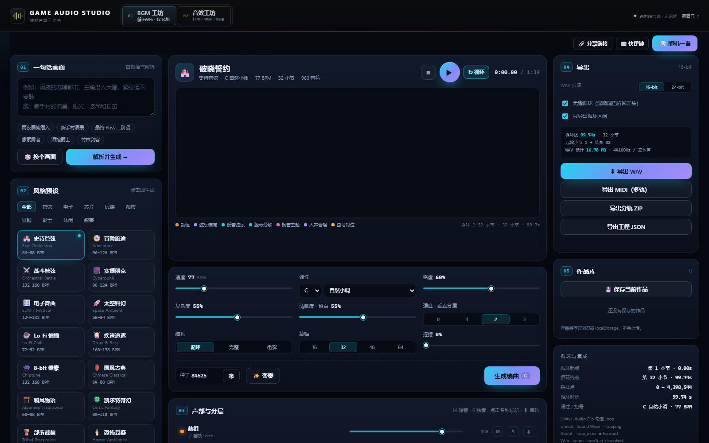

# Game Audio Studio · 游戏音频工作台

把 **LoopForge BGM 工坊** 与 **ForgeFX 音效工坊** 整合成一个页面、两个页签：

- **01 BGM 工坊**：19 种风格、垂直强度分层、FluidR3_GM 真实管弦采样 + 四声部人声、无缝循环、分轨 / MIDI / JSON 导出
- **02 音效工坊**：RPG 打击 / 交互 / 强化 / 技能 / 锻造，63 个预设、波形选择、组合技能音、WAV / 批量 ZIP



---

## 入口

仓库根目录就是统一工作台：

- 直接打开 [`index.html`](index.html)
- 或本地服务：

```bash
node test/server.js
# http://127.0.0.1:8099/
```

页签会同步 URL hash，可直接分享：

```
https://your.site/#bgm
https://your.site/#sfx
```

---

## 目录

```
/
├── index.html              统一外壳：品牌、两个页签、iframe、加载遮罩
├── apps/
│   ├── loopforge.html      BGM 单文件构建（由 game-bgm-studio 生成）
│   └── forgefx.html        音效单文件构建（由 rpg-sfx-studio 生成）
├── docs/preview-studio.png
├── build.js                构建两个子项目并复制到 apps/
├── test/                   外壳测试 + 本地静态服务器
├── game-bgm-studio/        BGM 源码 / 独立构建 / 测试 / 文档
└── rpg-sfx-studio/         音效源码 / 独立构建 / 测试 / 文档
```

两个子项目都可以**单独打开、单独构建、单独部署**：

- [`game-bgm-studio/README.md`](game-bgm-studio/README.md)
- [`rpg-sfx-studio/README.md`](rpg-sfx-studio/README.md)

---

## 为什么用两个 iframe

两个应用各自有完整的 CSS、全局变量、键盘监听和音频引擎，且存在大量同名 `class` / `id`。直接合并成一个文档会互相污染。

统一外壳用两个**同源 iframe** 承载：

- 样式、JS 全局、`AudioContext` 完全隔离
- 切换页签时两个应用状态都保留
- 音效页签**首次点击才加载**，首屏只加载 BGM
- 两个应用都支持 `?embed=1`：隐藏自身品牌和页脚，只保留操作区

---

## 构建

```bash
node build.js
```

依次：

1. 构建 `game-bgm-studio/dist/loopforge.html`
2. 构建 `rpg-sfx-studio/dist/forgefx.html`
3. 复制为 `apps/loopforge.html`、`apps/forgefx.html`

修改任一子项目后重新运行即可。

---

## 测试

静态服务器 + 无头 Chrome：

```bash
node test/server.js
# 另开终端
node test/cdp.js 9339 "http://127.0.0.1:8099/" "docs/preview-studio.png" "@test/browser.test.js"
```

覆盖：

- 两个页签、默认 BGM、音效延迟加载
- iframe 内 BGM / 音效就绪
- 嵌入模式隐藏自身品牌 / 页脚
- URL hash、标题、状态保留
- 响应式与无横向溢出

两个子项目还有各自更细的测试：

```bash
cd game-bgm-studio && node test/logic.test.js
cd rpg-sfx-studio && node test/logic.test.js
```

---

## 部署

**方式一：静态服务器 / GitHub Pages**

把整个仓库作为站点根目录上传即可，`index.html` 就是统一工作台。`apps/` 已包含两个单文件应用，不依赖子目录构建。

**方式二：只部署统一工作台**

上传 `index.html` + `apps/` + `docs/` 即可；子项目源码可以不传。

---

## 技术

- 纯前端、无依赖、无构建框架；每个子应用都是单文件
- Web Audio API 实时合成：振荡器、FM、噪声、滤波、卷积混响、压缩/限幅
- 可复现种子；音效支持 8 变体、波形覆盖、最多 4 层组合
- 导出：WAV（16/24-bit，44.1/48k）、ZIP 音效包、MIDI、JSON 工程

---

## 许可

MIT。生成的 BGM / 音效归你所有，可商用。
