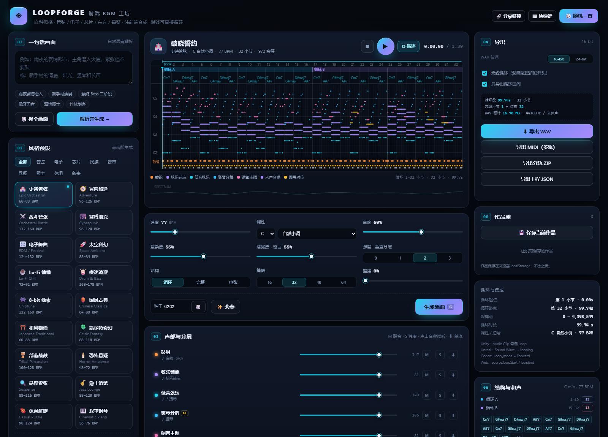
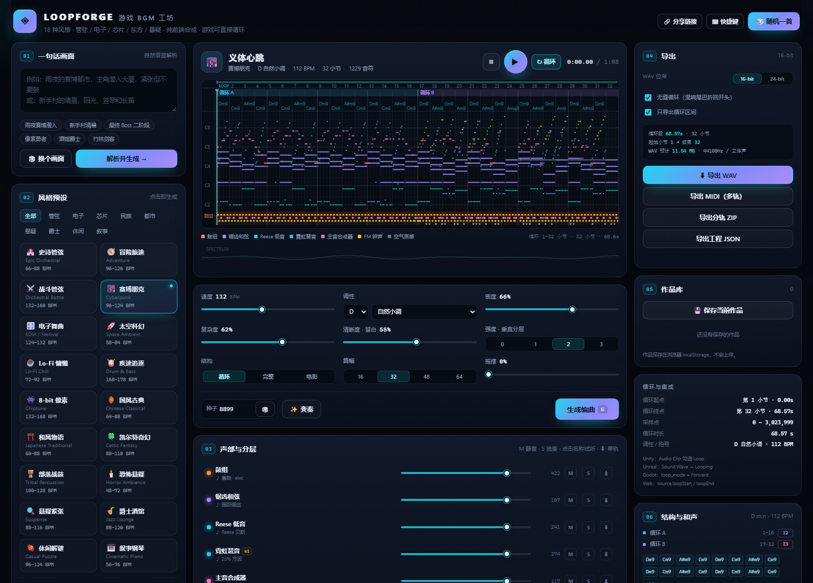

# LoopForge · 游戏 BGM 工坊

一个**纯前端、可复现、面向游戏开发**的程序化配乐生成器。
输入一句话画面，或者直接点一个风格，几毫秒内生成一首可循环的 BGM；支持 19 种风格、垂直分层、四声部人声合唱、无缝循环、分轨 / MIDI / 工程导出。

> 灵感来自 [五声工坊](https://www.lukezystudio.cn/music/) 的「一句话生成 + 纯前端合成 + 导出 WAV/MIDI」思路，
> 但把它从「中国五声音阶编曲台」扩展成了**游戏 BGM 生产工具**：加入现代电子 / 管弦 / 芯片 / 爵士等风格，
> 并把循环点、分层强度、分轨与引擎接入做成了默认能力。



---

## 快速开始

**方式一：直接双击**
打开 `index.html`（Chrome / Edge / Firefox 均可），无需安装任何依赖、无需服务器。

**方式二：单文件版**
`dist/loopforge.html` 是把 CSS/JS 全部内联后的单文件版本（约 288 KB），方便发给同事或放进项目仓库。

**方式三：本地服务**
如果浏览器对 `file://` 的本地存储有限制：

```bash
# 任选其一
python -m http.server 8080
npx serve .
```

然后访问 `http://localhost:8080`。

> 界面默认会生成一首「史诗管弦」。点 ▶ 或按空格试听；点风格卡片会立刻换风格；按 G 重新生成。

---

## 为什么适合游戏开发

| 能力 | 说明 |
| --- | --- |
| **19 种风格预设** | 管弦 / 电子 / 芯片 / 民族 / Lo-Fi / 爵士 / 恐怖 / 休闲 / 叙事，点击即生成 |
| **垂直分层强度 0–3** | 强度越高自动加入合唱、铜管对位、打击乐、冲击音效；一套素材覆盖探索 → 战斗 |
| **四声部人声合唱** | 女高音 / 女低音 / 中音 / 男高音，共振峰 + 气声 + 颤音，给史诗 / 战斗 / 恐怖增加厚度 |
| **清晰度 / 留白** | 0 = 满编，55 = 均衡，80+ = 极简；自动轮换色彩声部、抽稀节奏、做频率分工 |
| **段落动态** | 循环 A / B、A′、高潮等段落自动提升强度，循环点默认排除前奏与尾声 |
| **无缝循环** | 循环尾音回卷到开头（40ms 等功率交叉淡化），循环点写入 WAV 的 `smpl` 块 |
| **分轨导出** | 鼓 / 贝斯 / 和声 / 琶音 / 旋律 / 音效逐轨导出 ZIP，方便引擎内动态混音 |
| **MIDI 多轨** | 含速度、拍号、调号、段落 Marker 与 `LOOP_START` / `LOOP_END`，可进 DAW 二次编曲 |
| **工程 JSON** | 保存全部参数、音符与循环信息，可回读、可版本管理 |
| **可复现** | 同一个种子 + 参数 = 完全相同的编曲结果；分享链接包含全部参数 |
| **纯合成、无素材** | 所有音色由 Web Audio 实时合成，没有采样版权问题 |

> 想听人声：选「史诗管弦 / 战斗 / 恐怖」，强度 2–3，在调音台独奏「人声合唱」。
> 它是共振峰合成的四声部合唱，不是真人采样；真人录音需要可商用素材，见「已知限制」。

---

## 界面速览



```
┌──────────────┬───────────────────────────────┬──────────────┐
│ 01 一句话画面 │ 播放器 / 钢琴卷帘 / 频谱       │ 04 导出       │
│ 02 风格预设   │ 速度 / 调性 / 密度 / 复杂度     │ 05 作品库     │
│              │ 清晰度 / 强度 / 结构 / 篇幅     │ 06 结构与和声 │
│              │ 摇摆 / 03 声部与分层           │ 循环与集成    │
└──────────────┴───────────────────────────────┴──────────────┘
```

- **一句话画面**：中文自然语言解析，识别风格、场景、情绪、BPM、调性，甚至「不要鼓」。
- **风格预设**：按家族筛选；点击卡片立刻用该风格的默认速度 / 调式 / 密度生成。
- **清晰度 / 留白**：默认 55%，解决「声部太多、太乱」；往右更干净，往左回到满编。
- **钢琴卷帘**：按角色着色；可点击任意位置跳转播放头；顶部显示段落、和弦与循环区间。
- **调音台**：M 静音 / S 独奏 / 推子音量 / ⬇ 单独导出该声部；点击声部名可试听音色。
- **作品库**：存在浏览器 localStorage，不上传服务器。

### 快捷键

| 键 | 功能 |
| --- | --- |
| 空格 | 播放 / 暂停 |
| G | 重新生成 |
| R | 随机风格 |
| 1–4 | 强度 0–3 |
| Esc | 停止 |
| ← / → | 前后跳一小节 |

---

## 编曲清晰度：解决「声部太多、太乱」

程序化编曲很容易把所有层一次性堆出来：垫音 + 琶音 + 副旋律 + 色彩打击 + 混响，听感就糊了。
默认 **清晰度 55%** 会在「完整编排」之上再做一遍**精简与分工**：

1. **特征层轮换**：合唱、圆号、钟琴、副旋律等 `minIntensity >= 2` 的层只在高潮段出现，
   并且按 4 小节乐句轮流登场——不会再出现「所有色彩层同时压上来」。
2. **节奏抽稀**：琶音 16 分、鼓组色彩打击、16 分踩镲按清晰度降低密度；
   色彩声部每 4 小节只保留 1–2 个，其余明确休止（调音台会显示「本段休止」）。
3. **和声减脂**：铺底最多 3 音，并切掉与贝斯重叠的低音；跨声部同音自动去重。
4. **旋律让位**：与主旋律同音区、同时间的伴奏自动降低力度，必要时整段让开。
5. **频率分工**：垫音 / 琶音做高通，低频留给贝斯；混响与延迟随清晰度收敛。
6. **主旋律不动**：精简永远不会删主旋律音符，只处理伴奏与色彩层。

实测（32 小节史诗管弦，强度 2）：

| 指标 | 满编 (0%) | 默认 (55%) | 留白 (80%) |
| --- | --- | --- | --- |
| 平均同时发声音符 | 10.1 | 5.7 | 5.5 |
| 平均同时发声声部 | 5.0 | 3.6 | 3.4 |
| 鼓点 / 小节 | 13.4 | 10.8 | 9.8 |
| 主旋律音符 | 81 | 81 | 81 |

> 用法：默认 55% 已经比较干净；如果某个风格仍然偏密，把清晰度拉到 **75–90**，
> 或者把强度降到 **1**（只保留骨架与轻打击）。需要满编史诗感时再拉到 0。

---

## 风格清单

| 风格 | BPM | 适用场景 | 配器关键词 |
| --- | --- | --- | --- |
| 史诗管弦 | 66–88 | 主菜单、Boss、过场 | 弦乐铺底、铜管、定音鼓、合唱 |
| 凯旋史诗 | 134–148 | 最终决战、胜利、加冕 | 女高音独唱、弦乐断奏、太鼓、铜管号角 |
| 冒险旅途 | 96–126 | 大世界、城镇、任务 | 竖琴、长笛、拨弦、圆号 |
| 战斗管弦 | 132–160 | Boss 二阶段、追逐 | 弦乐固定音型、铜管重击、战鼓 |
| 赛博朋克 | 96–124 | 赛博都市、潜入 | Reese 贝斯、超级锯齿、霓虹琶音 |
| 电子舞曲 | 124–132 | 竞技场、活动 | 四踩底鼓、侧链和弦、上升音效 |
| 太空科幻 | 58–84 | 星图、科幻探索 | 玻璃 Pad、FM 钟声、低频 drone |
| Lo-Fi 慵懒 | 72–92 | 商店、房间、日常 | 电钢琴、行走贝斯、黑胶噪底 |
| 疾速追逐 | 168–178 | 载具追逐、跑酷 | 碎拍、Reese、铜管切分 |
| 8-bit 像素 | 132–168 | 平台跳跃、像素 RPG | 25% 方波、三角波贝斯、噪声鼓 |
| 国风古典 | 64–88 | 仙侠、东方幻想 | 古筝、笛子、二胡、太鼓 |
| 和风物语 | 60–88 | 武士、和风主城 | 筝、尺八、三味线、太鼓 |
| 凯尔特奇幻 | 88–118 | 奇幻世界、酒馆 | 小提琴、锡笛、竖琴、鲁特琴 |
| 部落战鼓 | 100–128 | 荒野、祭祀 | 手鼓、太鼓、人声长音、骨笛 |
| 恐怖悬疑 | 48–72 | 恐怖探索、精神污染 | 音簇、金属撞击、心跳、空气噪底 |
| 悬疑紧张 | 88–116 | 调查、潜行、解谜 | 弦乐脉冲、点状钢琴、滴答 |
| 爵士酒馆 | 88–120 | 酒馆、赌场、对话 | Walking Bass、电钢 Comping、鼓刷 |
| 休闲解谜 | 96–124 | 三消、经营、休闲关卡 | 马林巴、拨弦、钟琴 |
| 叙事钢琴 | 56–76 | 剧情演出、回忆、结局 | 钢琴分解、大提琴、弦乐 |

> 「凯旋史诗」参考了 Thomas Bergersen《Victory》的**配器与情绪走向**：
> 女高音无词独唱 → 弦乐断奏固定音型 → 太鼓 / 铜管推进 → 混声合唱。
> 没有使用原曲的旋律、和声进行或录音；建议 D 小调、BPM 138–144 试听。

---

## 游戏开发工作流建议

### 1. 先定「循环段」，再做变奏

- 结构选 **循环**：生成 16/32 小节的 A/B 循环，直接当背景音乐。
- 结构选 **完整**：自动加 4 小节前奏 + A / B / A′ / 尾声，循环点自动落在主体部分（导出的循环 WAV 只含主体）。
- 结构选 **电影**：铺陈 → 高潮 → 回落，适合过场。

### 2. 用强度做动态音乐

同一首曲子在引擎里需要「探索 → 战斗」的变化时：

1. 生成时把强度设为 2 或 3，导出**分轨 ZIP**。
2. 引擎里同时播放所有分轨（等长、同起点、已对齐循环点）。
3. 按游戏状态控制各分轨音量：
   - 探索：鼓 −12 dB、旋律 −3 dB
   - 战斗：全部 0 dB
   - 或直接用我们导出的「强度 0–3」四个版本各导一次，用交叉淡化切换。

### 3. 循环点怎么用

| 引擎 | 做法 |
| --- | --- |
| **Unity** | 导入 WAV → Inspector 勾选 Loop；或读 `manifest.json` 的 `loop.startSample/endSample` 设置 `AudioClip` 循环 |
| **Unreal** | Sound Wave → 勾选 Looping，填 Loop Start / Loop End（秒或采样点） |
| **Godot** | `AudioStreamWAV.loop_mode = LOOP_FORWARD`，`loop_begin / loop_end` 用采样点 |
| **FMOD / Wwise** | 导入后按 `manifest.json` 设置 Loop Region；分轨做垂直分层 |
| **Web** | `source.loop = true; source.loopStart = loop.startSeconds; source.loopEnd = loop.endSeconds` |

导出的 WAV 已写入标准 `smpl` 块（`numLoops = 1`，`playCount = 0` 表示无限循环），
部分工具（如 Reaper、部分音频中间件）会自动识别。

### 4. 需要二次编曲

导出 **MIDI**（多轨，含 Marker）拖进 Reaper / FL Studio / Cubase，替换音源后仍然保留和声、节奏与循环结构。
导出 **工程 JSON** 可以保留程序化参数，下次继续改。

---

## 导出说明

| 按钮 | 内容 |
| --- | --- |
| 导出 WAV | 44.1kHz / 16-bit 或 24-bit 立体声；可选「只导出循环区间」与「无缝循环」 |
| 导出 MIDI | SMF format 1，PPQ 480，多轨 + 速度 + 拍号 + 调号 + 段落 Marker + LOOP Marker |
| 导出分轨 ZIP | 每个声部一条等长 WAV + `manifest.json` + `README.txt` |
| 导出工程 JSON | 完整歌曲数据 + 循环元数据 + 引擎接入提示 |

文件名格式：`标题_风格_BPM_调性.wav`。

> 渲染时间与曲长成正比（离线 Web Audio 渲染）。16 小节约 10–20 秒，32 小节约 20–40 秒；
> 分轨只渲染自己的声部，会快很多。导出期间按钮会禁用并显示已用时间。

---

## 声音是怎么来的

全部为 **Web Audio 程序化合成**，没有加载任何音频文件：

- **振荡器层**：锯齿 / 方波 / 三角 / 正弦 / 自定义脉冲波（12.5%、25% 占空比），可叠加 detune 做合唱。
- **人声合唱**：女高音 / 女低音 / 中音 / 男高音四个声部；每个声部用锯齿波激励 + 3 组元音共振峰（“啊”）、气声噪声和颤音，形成合唱而不是正弦垫。
- **FM**：调制器 → 增益 → 载波频率，用于电钢琴、FM 钟声。
- **包络**：ADSR + 滤波包络 + 音高包络（808 下滑、拨弦瞬态）。
- **管弦音色**：弦乐加入琴体共振、弓毛气声、四层 detune 与慢起音；铜管加入号体共振、气流噪声和更自然的起音；定音鼓/太鼓加长尾与鼓皮噪声。
- **厅堂混响**：程序生成**立体声厅堂 IR**（预延迟、早期反射、高频阻尼、左右去相关），按风格给不同长度与湿度，不再共用一块“金属板”。
- **总线**：低中频让位、2.8 kHz 存在感、M/S 立体声宽度、极轻饱和、慢起音压缩与限幅。
- **噪声层**：钢琴击弦、长笛气声、军鼓、镲片、黑胶噪底、上升音效。
- **混音**：管弦鼓组做 105 Hz 低架衰减并降低鼓组总线，让弦乐、铜管、人声从低频里浮出来；史诗/战斗加入断奏弦乐固定音型，减少“Pad 铺底”的电子感。

所有音符由乐理引擎生成：音阶 → 和弦级数 → 声部排列 → 节奏模板 → 动机 / 模进 / 终止式。

---

## 文件结构

```
game-bgm-studio/
├── index.html              入口（普通多文件版本）
├── build.js                打包成 dist/loopforge.html 单文件
├── package.json            只有 build / test 两个脚本，无第三方依赖
├── dist/loopforge.html     单文件版本（构建产物）
├── docs/                   预览截图
├── css/style.css           界面样式
├── js/
│   ├── util.js             可复现随机数、节奏/存储工具
│   ├── theory.js           音阶、和弦、声部连接、调性
│   ├── styles.js           19 种风格预设（数据）
│   ├── instruments.js      Web Audio 合成音色库 + 鼓组
│   ├── composer.js         段落、和声、鼓、贝斯、琶音、旋律、分层
│   ├── audio.js            实时调度 / 离线渲染 / 混音总线
│   ├── midi.js             MIDI 编码
│   ├── wav.js              WAV 编码（smpl 循环块）+ 接缝处理
│   ├── zip.js              分轨 ZIP 打包
│   ├── prompt.js           中文自然语言解析
│   ├── ui.js               卷帘、频谱、卡片、调音台渲染
│   └── app.js              状态、交互、导出、作品库
└── test/                   逻辑 / 导出 / 浏览器自测 / WAV 分析脚本
```

---

## 扩展指南

### 加一种风格

在 `js/styles.js` 里加一个对象即可（参考任意现有条目）：

```js
{
  id: 'myStyle', name: '我的风格', en: 'My Style', emoji: '🎮',
  family: 'electronic', color: '#22d3ee',
  desc: '一句话描述', tags: ['标签'], usage: ['场景'],
  bpm: [100, 120], swing: 0,
  modes: ['minor', 'dorian'], defaultMode: 'minor',
  progs: ['i_Vi_III_VII'],          // 见 theory.js 的 PROGRESSIONS
  extension: 1, density: 0.6, complexity: 0.55,
  drums: { kit: 'elec', steps: {...}, fillEvery: 8, fillType: 'hat', intensity: {1:['hat'],2:['clap'],3:['openhat']} },
  layers: [ /* 用 L(...) 定义声部、音色、pattern、minIntensity */ ],
  reverb: 0.3, delay: 0.1, width: 0.8, gain: 0.9
}
```

`pattern` 可用的生成器：`sustain` `swell` `stab` `strum` `comp` `arp8` `arp16` `arpUpDown` `broken` `ostinato16`
`melody` `counter` `sparse` `root` `pulse8` `pulse16` `offbeat` `walk` `octave` `sub` `pedal` `gallop` `air` `vinyl` `sweep`。

### 加一种音色

在 `js/instruments.js` 的 `DEFS` 里加一个合成器描述（振荡器、包络、滤波、颤音、噪声、发送量），
再在 `styles.js` 的层里引用它的 id。鼓组在 `DRUMS` / `KITS` 里扩展。

### 加提示词

`js/prompt.js` 的 `STYLE_WORDS` / `SCENES` / `MOODS` 三个关键词表，按权重叠加即可。

---

## 测试

```bash
# 纯逻辑：全部风格生成、确定性、和弦声部合法性
node test/logic.test.js

# 导出层：WAV 16/24-bit、smpl 循环块、接缝、manifest、MIDI、ZIP
node test/export.test.js

# 浏览器内：播放、离线渲染、WAV/MIDI、提示词、分层、静音、作品库、循环接缝
# 需要先启动一个可被 CDP 访问的 Chrome（测试脚本见 test/cdp.js）
node test/cdp.js 9333 "file:///.../index.html" - "@test/browser.test.js"

# 分析导出的 WAV：峰值/RMS/频段/立体声/循环接缝
python test/analyze_wav.py test/downloads/xxx.wav

# 构建单文件版
node build.js
```

---

## 已知限制

- 合成器偏「音色设计」而非真实采样，管弦音色的真实感有限；这轮升级集中在厅堂混响、管弦音色、鼓组混音与立体声，仍是合成器。要再上一个台阶，需要可商用采样库或你自己的录音；换 MIDI 进 DAW 用采样音源也是更好的选择。
- 人声合唱是**共振峰合成**，不是真人录音；要真人女高音/男高音采样，需要可商用音源或自行录制，再作为采样层接入。
- 复杂风格（电子、战斗）音符密度高，导出渲染会慢一些；这是 Web Audio 离线渲染的固有成本。
- 生成结果受浏览器音频时钟影响很小，但不同浏览器的混响/压缩器实现会有细微差别。
- 作品库只存在本机浏览器，清理站点数据会丢失；重要作品请导出 JSON / WAV。

---

## 许可与素材

- 生成的音乐由你自由使用（包括商业游戏），无需署名。
- 代码可自由修改；如果用于公开项目，欢迎注明 LoopForge。
- 界面与实现为本项目原创；参考站仅作为产品思路来源。
