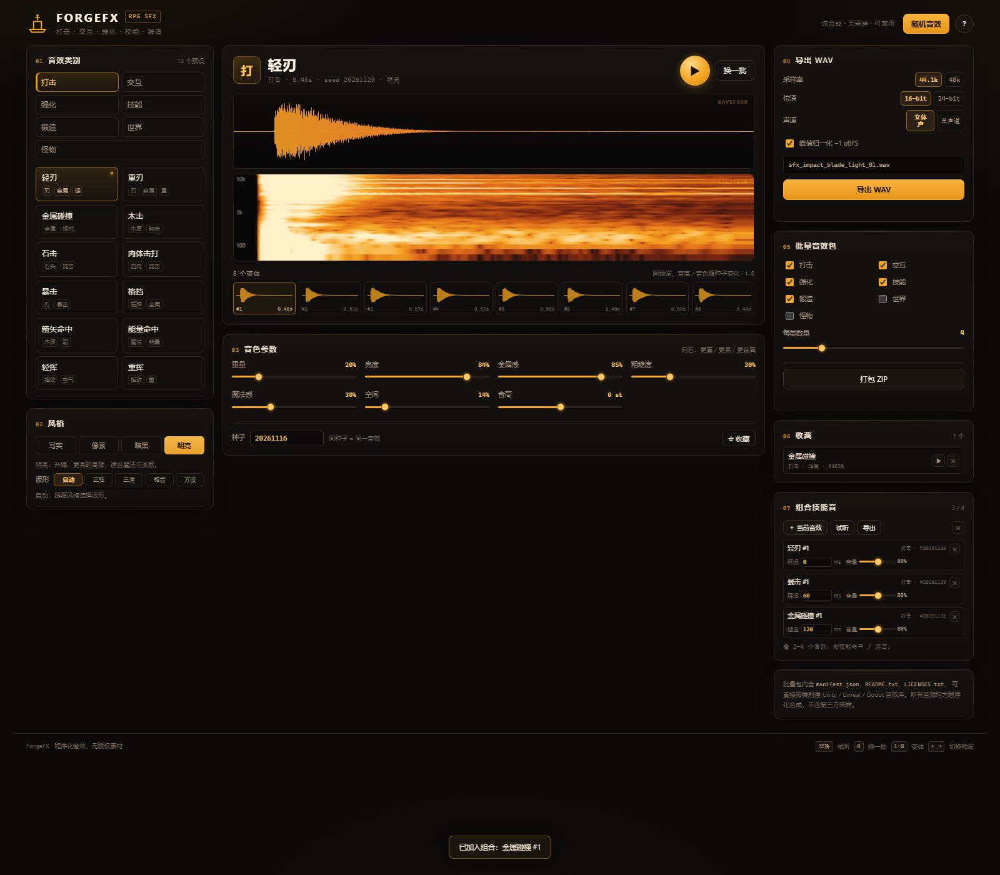

# ForgeFX · RPG 音效工坊

程序化生成游戏音效的纯前端工具：**打击、交互、强化、技能、锻造、世界、怪物**，7 大类 63 个预设，每个预设一次生成 8 个变体。

所有声音由 Web Audio 实时合成，**不含任何第三方采样**，生成的音频可商用。



---

## 快速开始

直接双击 `index.html`，或：

```bash
cd rpg-sfx-studio
python -m http.server 8080
# 打开 http://localhost:8080
```

Chrome / Edge / Firefox 均可。无需安装依赖、无需构建。

推荐流程：

1. 左侧选 **类别 → 预设**，中间会生成 8 个变体。
2. 点变体试听，用 **重量 / 亮度 / 金属感 / 粗糙度 / 魔法感 / 空间 / 音高** 微调。
3. 用 **风格** 切换整套音色：写实 / 像素 / 暗黑 / 明亮；再用 **波形** 覆盖振荡器音色。
4. 需要技能命中/连击时，把音效加入 **组合技能音**（最多 4 层，可设延迟与音量）。
5. 右侧 **导出 WAV**，或按类别 **批量打包 ZIP**。
6. 喜欢的一版点 **☆ 收藏**，种子和参数都会保存。

---

## 音效清单（63 个）

| 类别 | 预设 |
| --- | --- |
| **打击** (12) | 轻刃、重刃、金属碰撞、木击、石击、肉体击打、暴击、格挡、箭矢命中、能量命中、轻挥、重挥 |
| **交互** (11) | 悬停、点击、确认、取消、错误、金币、拾取、翻页、切换、任务完成、升级 |
| **强化** (8) | 力量提升、附魔、镶嵌宝石、精炼成功、精炼失败、护盾生成、持续治疗、属性提升 |
| **技能** (12) | 火焰施法/命中、冰霜施法/碎裂、雷电蓄力/落雷、治疗术、增益光环、诅咒、召唤、神圣、暗影 |
| **锻造** (8) | 铁锤敲击、铁砧、风箱、淬火、打磨、锻造成功、锻造失败、点燃熔炉 |
| **世界** (8) | 开门、宝箱、拉杆、药水、脚步·草地/石头/木板、火把 |
| **怪物** (4) | 低吼、受击、死亡、咆哮 |

每个预设都有独立的配方：材质、瞬态、主体、尾音、空间感都不同，不是简单变调。

> **刃类与钝击是分开的配方。**
> 轻刃 / 重刃 / 暴击使用 `slash` 配方：高频刃风扫频 + 4–10ms 刃口瞬态 + 高频金属 shing + 少量低频“握手感”，
> 频谱重心明显高于钝击。金属碰撞 / 格挡仍是金属钝击，木击 / 石击 / 肉体击打是材质钝击，
> 不应有切割感——这是刻意区分，不是同一个声音换参数。

---

## 四种风格

| 风格 | 特点 |
| --- | --- |
| **写实** | 自然的瞬态、金属泛音与混响，适合大多数 RPG |
| **像素** | 方波/短促、几乎无混响，适合 8-bit / 复古 |
| **暗黑** | 整体降调、更多失真与长混响，适合魂系 / 恐怖 |
| **明亮** | 升调、更亮的高频，适合魔法、奖励、休闲 |

风格会改变振荡器波形、音高、失真和混响量；切换后当前 8 个变体会重新渲染。

---

## 参数

| 参数 | 作用 |
| --- | --- |
| 重量 | 低频比例、衰减长度；越高越“重” |
| 亮度 | 滤波截止与高频噪声 |
| 金属感 | 非谐波泛音 / FM 比例 |
| 粗糙度 | 噪声、失真、摩擦感 |
| 魔法感 | 扫频、shimmer、FM 钟声 |
| 空间 | 混响与立体声宽度 |
| 音高 | ±12 半音整体移调 |

- **种子**：同一个种子 + 同一组参数 = 完全相同的音效，可复现、可分享。
- **8 个变体**：同一预设下 8 个相关但不同的种子，方便挑选“这一击”。

### 关于 8 个变体

每个变体除了种子不同，还会在预设基础上做一层**种子化微差**：

- 音高 ±2 半音左右
- 起音亮度、瞬态长度
- 主体衰减、金属泛音基频与分音组合
- 左右声像、少量砂砾/火花层

所以「换一批」得到的是**同风格但明显不同的 8 发**，不是简单复制；滑杆设置的是这一组变体的“基准值”。
「随机音效」则会直接换一个预设，不会停在原地只换种子。

---

## 波形与组合技能音

### 波形

风格决定“默认波形”，你也可以手动覆盖：

| 波形 | 听感 |
| --- | --- |
| **自动** | 跟随风格（像素→方波/三角，暗黑→锯齿，明亮→三角） |
| **正弦** | 柔和干净，适合魔法、治疗、UI |
| **三角** | 比正弦多一点边缘，适合提示音 |
| **锯齿** | 明亮、有攻击性，适合复古与能量 |
| **方波** | 硬朗、8-bit，适合像素游戏 |

波形只影响有音高的 `tone` 层；噪声与金属分音层不变，所以不会把“刃风”变成方波噪声。

### 组合技能音

右侧「组合技能音」可以把当前变体叠成一层（最多 4 层）：

- **延迟**：0–2000ms，做“命中 → 余响 / 二次爆炸”
- **音量**：0–150%，平衡各层
- **试听**：实时混合
- **导出**：生成一个混合好的 WAV，峰值归一化到 −1 dBFS

典型用法：

- 火焰命中 = 火焰命中 + 岩石碎裂（延迟 30ms）
- 暴击 = 轻刃 + 暴击铃声 + 低音冲击（延迟 0/10/20ms）
- 锻造成功 = 铁锤 + 成功和弦（延迟 80ms）

组合会保存在 localStorage，刷新页面后仍在；清空用「✕」。

---

## 导出

### 单个 WAV
- 44.1k / 48k
- 16-bit / 24-bit
- 立体声 / 单声道
- 峰值归一化到 **−1 dBFS**（可关闭）
- 文件名：`sfx_<类别>_<预设>_<变体序号>.wav`

### 批量音效包
- 勾选类别，设置“每类数量”（2–12），一键生成 ZIP。
- 目录结构：

```
SFX/
  Impact/  blade_light_01.wav ...
  UI/      ui_click_01.wav ...
  Buff/    ...
  Skill/   ...
  Forge/   ...
  World/   ...
  Monster/ ...
  manifest.json
  README.txt
  LICENSES.txt
```

- `manifest.json` 包含每个文件的类别、标签、种子、风格、时长、峰值与宏参数，方便在引擎里建音效库。
- 所有音频均为程序化合成，`LICENSES.txt` 明确说明可商用、无需署名。

---

## 引擎接入

| 引擎 | 做法 |
| --- | --- |
| **Unity** | 直接把 WAV 拖入 `Assets`；AudioClip 默认设置即可。可按 `manifest.json` 生成 `SfxLibrary` ScriptableObject。 |
| **Unreal** | 导入为 Sound Wave；需要随机变体时建 Sound Cue + Random 节点。 |
| **Godot** | 导入为 AudioStreamWAV；单声道文件可勾选“单声道”导出以省内存。 |
| **FMOD / Wwise** | 以 `sfx_<类别>_<预设>_<序号>` 作为事件命名，类别作为事件文件夹。 |

建议：
- 2D UI 音效导出 **单声道**，由引擎做声像；3D 世界音效保留立体声。
- 短促 UI 音效不要加长混响；本工具默认已按类别控制。
- 战斗打击建议每个预设保留 2–3 个变体，避免重复感。

---

## 快捷键

| 键 | 功能 |
| --- | --- |
| 空格 | 试听 / 停止 |
| R | 换一批（新种子） |
| 1–8 | 切换变体 |
| ← / → | 上一个 / 下一个预设 |
| Esc | 关闭说明 |

---

## 技术结构

```
rpg-sfx-studio/
├── index.html
├── css/style.css
├── js/
│   ├── util.js        可复现 RNG、工具、localStorage
│   ├── wav.js         WAV 16/24-bit 编码、峰值归一化、下混
│   ├── zip.js         ZIP（store 模式）
│   ├── presets.js     7 类 63 预设 + 配方构建（纯逻辑，可在 Node 测试）
│   ├── engine.js      Web Audio 合成、离线渲染、试听播放器
│   ├── ui.js          预设卡片、波形、频谱、参数、变体、收藏
│   └── app.js         状态、渲染流程、导出、批量包、收藏、分享链接
├── test/
│   ├── logic.test.js  756 份配方 + WAV/ZIP 校验
│   ├── browser.test.js 真实 Chrome 渲染/UI 断言
│   └── cdp.js         Chrome DevTools Protocol 测试驱动
├── build.js           内联成单文件 dist/forgefx.html
└── docs/preview.png
```

### 合成模型

每个音效由若干“层”组成：

- **noise**：白/粉红噪声 + 滤波扫频 + 包络 + 声像/颤音
- **tone**：正弦/三角/锯齿/方波 + 音高包络 + 滤波 + FM + 颤音
- **metal**：一组非谐波正弦分音，模拟金属/冰块/钟声

再经过：失真（WaveShaper）→ 压缩 → 限幅 → 高通 → 归一化；混响为程序生成的短 IR。

### 为什么不用采样
- 无版权风险，生成的音频可商用。
- 体积小：整个工具 < 150 KB。
- 可无限变体、可调参数、可复现。
- 对“打击感/魔法感”这类风格化音效，合成比找采样更快。

如果需要真实脚步/布料，可以后续加“采样导入层”，把 WAV 当作瞬态叠在合成层上。

---

## 构建单文件

```bash
node build.js
# 输出 dist/forgefx.html（约 136 KB）
```

单文件版本可以直接发给别人，或放到静态服务器 / GitHub Pages。

---

## 测试

```bash
node test/logic.test.js
```

覆盖：
- 63 预设 × 4 风格 × 3 种子 = 756 份配方
- 所有层参数有限、时长/增益合法
- 同种子可复现、不同种子不同
- 音高 +12 半音约翻倍
- 像素风格混响更少
- WAV 16/24-bit 头与数据长度、−1 dBFS 归一化
- ZIP CRC32、文件数、EOCD

浏览器测试（需要本机 Chrome）：

```bash
# 先启动无头 Chrome（--remote-debugging-port=9334）
node test/cdp.js 9334 "file:///.../rpg-sfx-studio/index.html" "docs/preview.png" "@test/browser.test.js"
```

覆盖：8 变体渲染、63 预设 × 2 风格真实渲染无静音/NaN、刃类高频占比高于钝击、打击变体 PCM 差异、波形/频谱绘制、波形覆盖、组合技能音混合、预设/风格/参数/变体联动、播放、WAV 导出、批量 ZIP、收藏、三列布局与无横向溢出。

---

## 参考分析：Pixel Soul Studio

参考页 `pixelsoulstudio.dpdns.org` 本身是一个**像素画工具官网**，`#gallery` 是像素作品展示，不是音效库。它的「8bit 音效」是**闭源桌面版功能**，前端只包含营销页、功能卡片和一张截图，没有公开的音效合成代码或音频素材。

从该功能页能确认的能力描述：

- 选择预设与波形，调整单个音效
- 制作循环 BGM，编排旋律与节奏
- 打击垫演奏、组合技能音与录制
- 收藏音效，在互动场景中试听
- 导出 WAV，设置自动保留

据此补充到 ForgeFX 的部分：

- **波形选择**（自动 / 正弦 / 三角 / 锯齿 / 方波）
- **组合技能音**（最多 4 层，延迟 / 音量，混合试听与导出）

暂未实现、可继续加的部分：

- 打击垫演奏与录制
- 更完整的“互动场景试听”（普攻 / 受击 / 拾取 / 升级 / 锻造 一键试听）
- 循环 BGM（已有独立的 BGM 工坊，不重复造）

> 以上只做功能与交互层面的参考，没有复制该站的代码、图片或音频；ForgeFX 的合成、配方与 UI 均为本项目实现。

---

## 已知限制

- 目前是纯合成，没有内置采样；脚步/布料等可后续加导入。
- 响度只做峰值归一化，不做 LUFS；游戏内通常由 AudioMixer 统一控制。
- 浏览器端 WAV 编码，长音效批量导出会占用一些内存；63 个预设全量打包建议分批。
- 组合最多 4 层，暂不支持录制与打击垫。
- 推荐 Chrome / Edge；Safari 的 `OfflineAudioContext` 行为可能有差异。

---

## 许可

MIT。生成的音频归你所有，可商用、无需署名。
